# 万界秘境 · Myriad Veil

修仙动作 RPG：**打 BOSS、养装备、集法宝**。BOSS 首杀之后，能**永久学会它自己的招式**；再用卡牌自走棋与 Roguelite 轮换玩法防止刷腻。

**Godot 4.7 / GDScript**，Windows 与 Android 双端，单人开发。

> ▶ **[下载试玩版：Windows / Android](https://github.com/Liyaxuan-XWA/myriad-veil/releases/latest)**（免安装，约 250–320MB）
>
> 这份仓库是**作品集版本**：代码、工具链与设计文档齐全；美术资源与字体已裁剪（见文末「关于这份仓库」）。

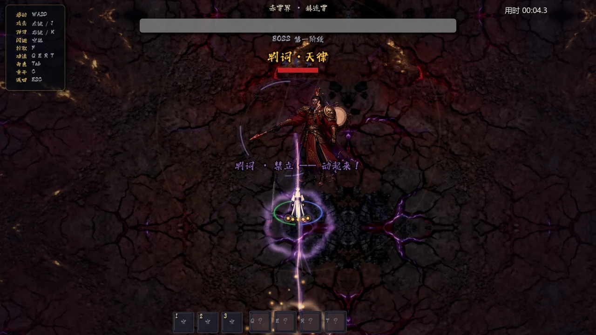

## 玩法

- **打 BOSS，养装备**：五个位面的守关者与区域核心，每只两阶段 + 专属机制；装备可锻造、强化随机词条、铸神成神器。
- **学 BOSS 的招式**：功法的唯一获取途径是「击杀真实位面 BOSS → 解锁塔投影 → 首杀感悟 → 永久习得」。BOSS 用什么招，玩家学会后就用同一套招式形态数据，只是消耗与数值各自结算。
- **多种法宝**：凝水佩、逐电环、太极盘、三炁环身……各有独立冷却与打法定位，死亡必掉。
- **三套循环防止玩腻**：位面主线（动作战斗）→ 万界塔（逐层挑战）→ 卡牌自走棋「万界棋坛」（含 Roguelite 关卡与快速模式）。
- **大世界与设施**：练气到化神五个区域、采药炼丹、制符、灵田、仓库、万界图鉴、演武场。

## 战斗

| | |
| --- | --- |
| <br>赫连霄 · 判词·天律（两阶段，判词四律 + 雷势） | 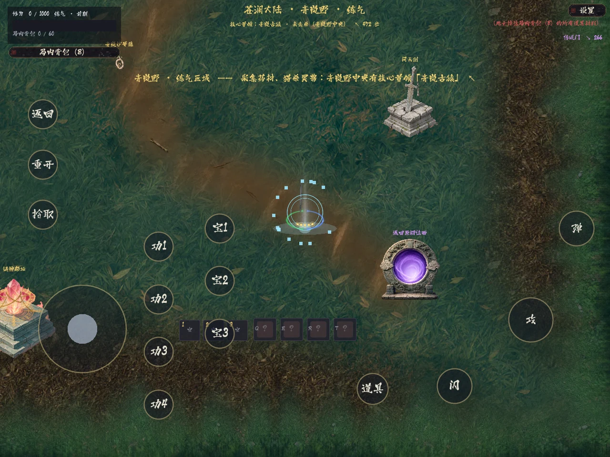<br>手机端：左下摇杆 + 攻 / 弹 / 闪 / 功 1~4 |

## 世界

| | |
| --- | --- |
| 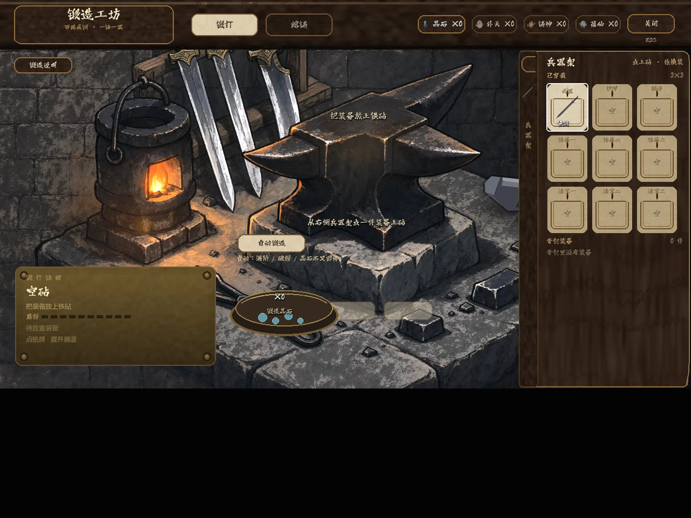<br>原初位面（主城）：设施入口与任务指引 | 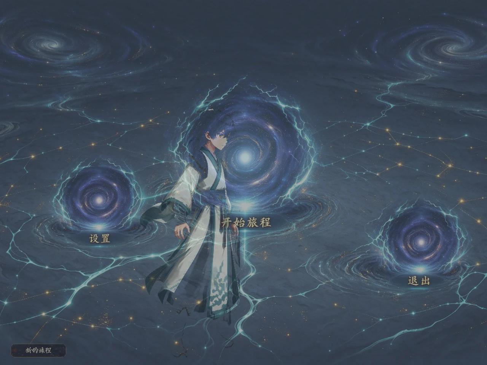<br>苍澜大陆 · 青岚野 |
| 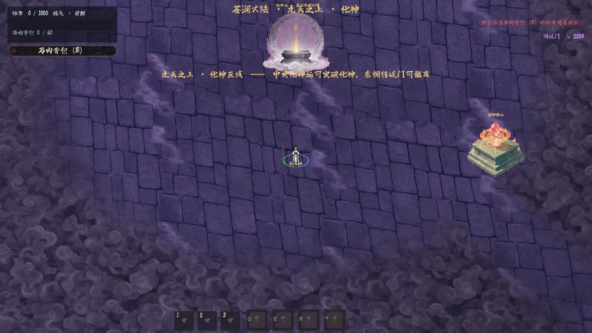<br>九天之上：玉台与云海 | 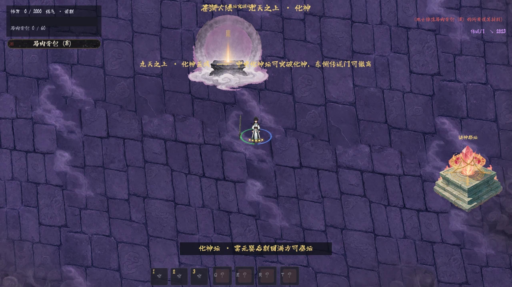<br>化神坛：开过九天门才能进来突破化神 |

## 养成与图鉴

| | |
| --- | --- |
| 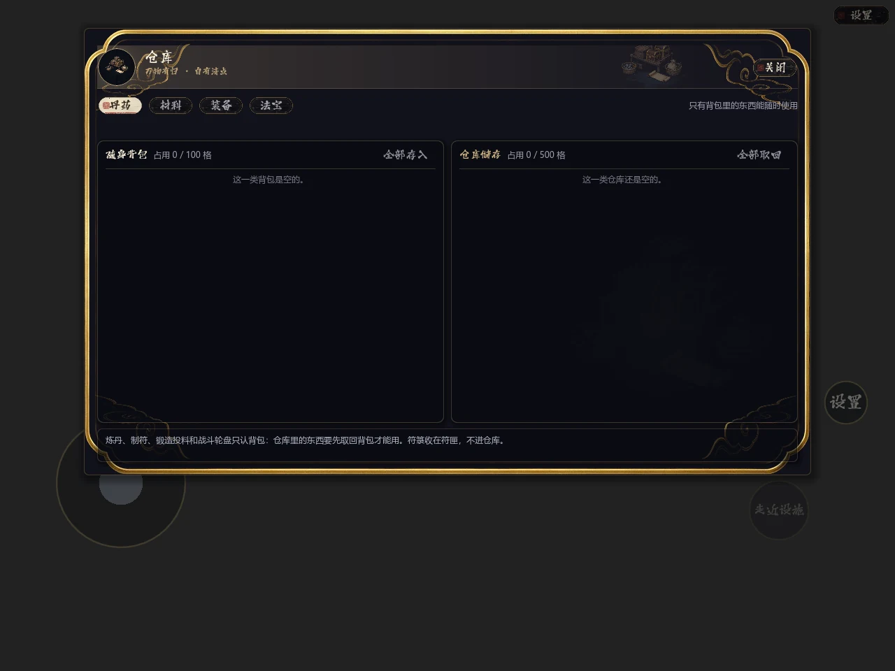<br>锻造台：上砧、随机词条、自动落锤 | 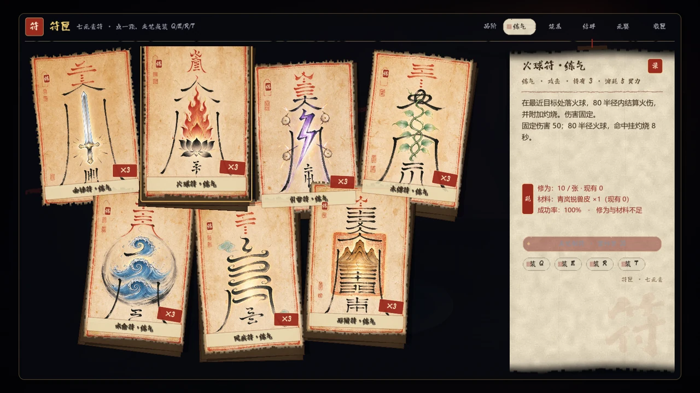<br>制符台：七系元素符，品阶印嵌进符胆 |
| 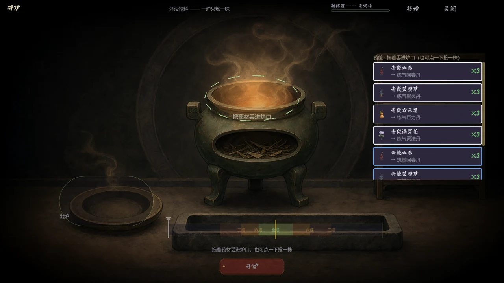<br>炼丹炉：一炉只炼一味，火候分三成到十成 | 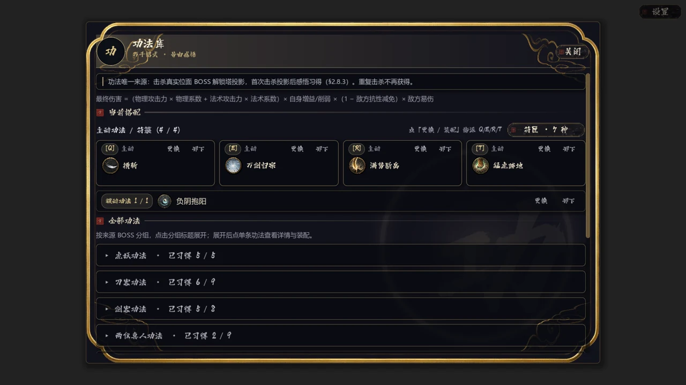<br>功法库：4 键主动槽 + 被动 + 门派分册 |
| 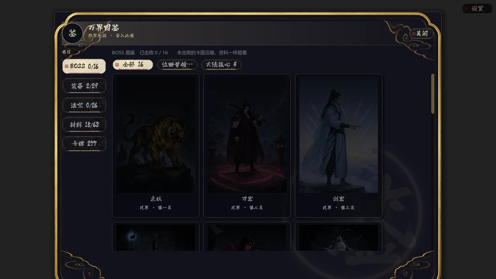<br>万界图鉴：BOSS 卡与属性 | 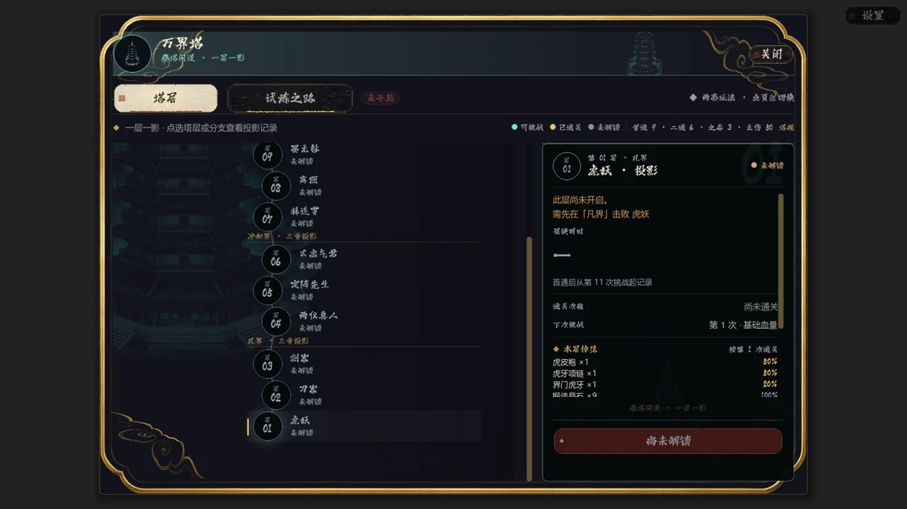<br>万界塔：逐层挑战与讨伐详情 |
| 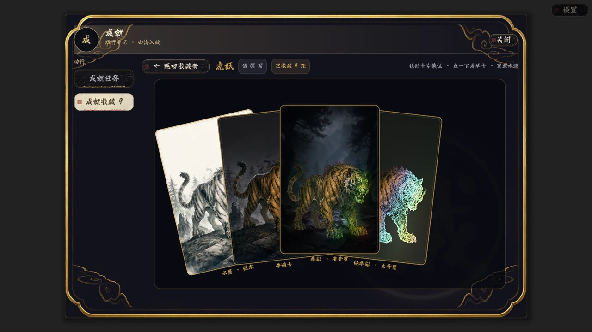<br>成就收藏 · 虎妖四张卡（普通 / 华彩·有背景 / 纯华彩 / 纸本水墨） | 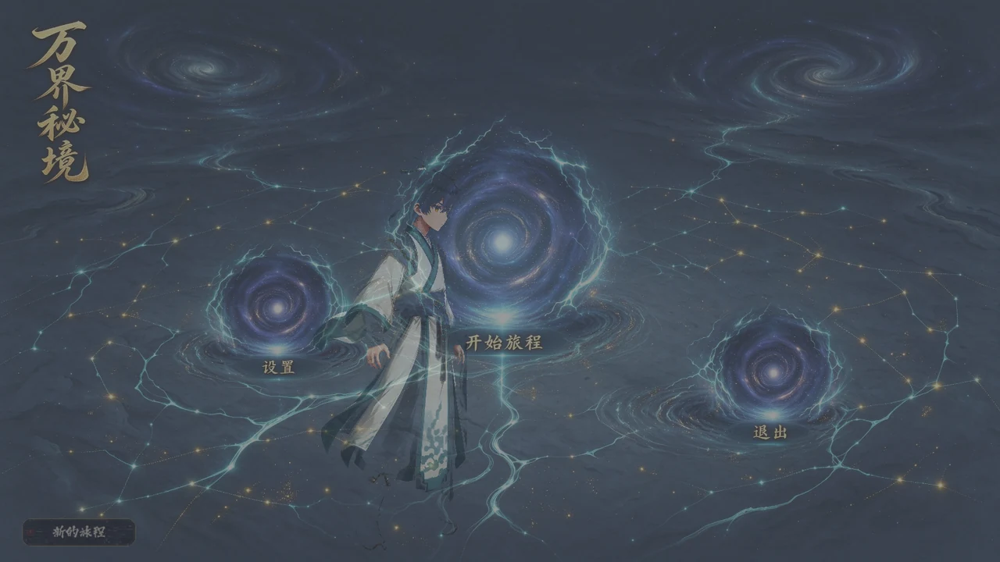<br>开始界面 |

## 技术与规模

| | |
| --- | --- |
| 引擎 | Godot 4.7.2，纯 GDScript（无 C#、无第三方框架） |
| 代码 | **198 个 .gd，约 12 万行**；15 张数据表；32 个场景 |
| 工具链 | **125 个 Python 工具** + **228 个无头探针** + **153 个截图工具** |
| 平台 | Windows（导出单文件 exe）+ Android（arm64 APK） |
| 时间 | 2026-10 起持续开发 |
| 我做的事 | 一个人：玩法与系统程序、数值/经济、UI、美术管线（AI 生成 → Python 批处理 → 实机像素对账）、自动验证体系 |

## 架构：数据与表现分离

所有内容都在 `scripts/data/` 的数据表里定义，逻辑只读表：

```
item_db.gd  art_db.gd   skill_db.gd  attribute_db.gd  buff_db.gd  debuff_db.gd
move_db.gd  quest_db.gd rogue_db.gd  secret_world_db.gd  talisman_db.gd
codex_db.gd tutorial_db.gd world_db.gd boss_rig_data.gd
```

- **BOSS 框架**：`boss_base.gd` 统一状态机（入场/出招/受击/两阶段/死亡），每只 BOSS 只写自己的机制层；骨骼 rig 动画、`SkillFx` 特效通道、按剪影拟合的受击球。
- **战斗结算**：`battle_resolver.gd` 集中处理伤害类型（物理/法术）、八元素与抗性、暴击与减伤；资源系统（势、日冕、雷势等）挂在统一属性层。
- **存档**：4 个自动轮转槽 + 1 个手动槽，原子写盘 + 备份 + 坏档识别，退出游戏前必有「保存并退出」确认。
- **UI**：`SystemPanel` 基类统一面板生命周期；`UIKit` 统一配色/字体/质感；图鉴、BOSS 卡面、华彩卡都有独立 shader。
- **手游输入层**：`virtual_pad.gd` 摇杆/按键 + 合成鼠标判定闸门、安全区布局、按短边缩放、浮层「可点矩形」让路。

## 工程亮点

### 1. 自动验证体系：探针 + 变异验证

每个功能配一个**无头探针**（headless 断言，读引擎真实状态，不手喂标记）；关键实现再做**变异验证**——故意改坏一行，必须让指定断言变红；不红就说明断言是假绿，回头修断言。

- `tools/probe_*.gd` 228 个；`tools/shot_*.gd` 153 个（窗口化实机截图对账）。
- 例：`probe_drag_scroll.gd`（38 项）配套 `.scratch/drag_scroll/mutate.py`（15 条变异）。
- 变异驱动会做原始字节备份、`finally` 还原、锚点唯一性干跑，跑完自动复原源码。

这套体系抓过不少真 bug：玩家旗被引爆后 BOSS 仍指向已释放节点导致闪退、攻速过快时平 A 出伤帧落在窗口外导致「空挥」、面板暂停时虚拟键全灭、机关门吞点击、滚动列表拖一下变点一下。

### 2. 补引擎缺口：全局「按住拖动滚动」

实测本版引擎的 `ScrollContainer` 既不吃鼠标拖动也不吃手指拖动（五种 `mouse_filter` 组合 + `ScreenDrag` 全都不动）。用 autoload `scroll_drag.gd` 接管：滚动条、GUI 拖拽源、文本框、华彩卡/手牌四类让路，拖动过的那发 release 要吞掉（否则变成点按钮）。全项目 24 个滚动区一次生效，PC 与手机共用一条事件路径。

### 3. 美术管线

AI 生成立绘/图标 → Python 抠图（泛洪 + 软边 + 去溢色）、色键、图集烘焙、九宫格与描边 → 按**实机显示尺寸**做像素对账（截图 + PIL 比对），而不是只看贴图指标。BOSS 动画走 rig 骨骼而不是序列帧（帧数天花板与漂移问题）。

### 4. 移动端专项

- 触摸 → 合成鼠标的事件顺序是实测出来的，不是猜的；
- 「推摇杆误触设施」的根因是摇杆先吃掉了按下：改成按落点判定 + 进入键三态回执；
- 教程卡压在摇杆区上导致按钮点不了：浮层上报「可点矩形」，命中就不认领；
- 不需要虚拟键的界面（开始界面、棋坛）自动收起。

## 目录结构

```
scripts/
  boss/       BOSS 框架与 16 只 BOSS 的机制层
  combat/     战斗场景、玩家、投射物、刀痕
  data/       15 张数据表（物品/美术/功法/属性/任务/图鉴/世界…）
  match/      卡牌自走棋「万界棋坛」
  systems/    存档、角色数据、战斗结算、虚拟摇杆、教程、BGM…
  ui/         面板（图鉴/锻造/功法/仓库/塔/成就…）与 UIKit
  world/      大世界场景与区域内容
  visual/     特效与美术表现
tools/        125 个 Python 工具 + 228 个探针 + 153 个截图工具
docs/         设计文档、任务书、踩坑记录（78 篇）
scenes/       32 个场景
addons/       自研编辑器插件（特效工坊）
assets/       仅保留 shader / 特效 / 图标（美术与字体已裁剪）
```

## 关于这份仓库

- **不含完整美术与字体**：完整 `assets/` 约 450MB（含一套 21MB 的中文书法字体，授权仅限个人使用），不适合放进公开仓库；因此**不能 clone 后直接运行**，Godot 打开会提示缺失资源，属预期。
- 想直接玩：[Releases](https://github.com/Liyaxuan-XWA/myriad-veil/releases/latest) 里有 Windows 免安装 exe 与 Android APK；完整工程（含美术与字体）可以单独提供。
- 代码、工具、文档都是真实开发过程产物，未做「展示用」精简。

## 文档

`docs/` 里有 78 篇开发文档，例如：

- `项目概览.md`、`当前阶段成果总结.md`、`任务书交接包.md`
- `触屏操作与按键布局.md`（手游输入层完整设计与踩坑）
- `存档机制与备份.md`、`功法与招式体系.md`、`BOSS设计规范.md`
- Godot 4.7 特有的坑：暂停/`process_mode`、锚点与 `MouseFilter`、`push_input` 与合成鼠标、文本换行撑爆布局、编辑器类缓存……

## 许可

代码仅用于作品展示与阅读，未经许可不得商用、再发布或用于训练；
游戏名、角色、文案、美术与音频版权归作者所有。
